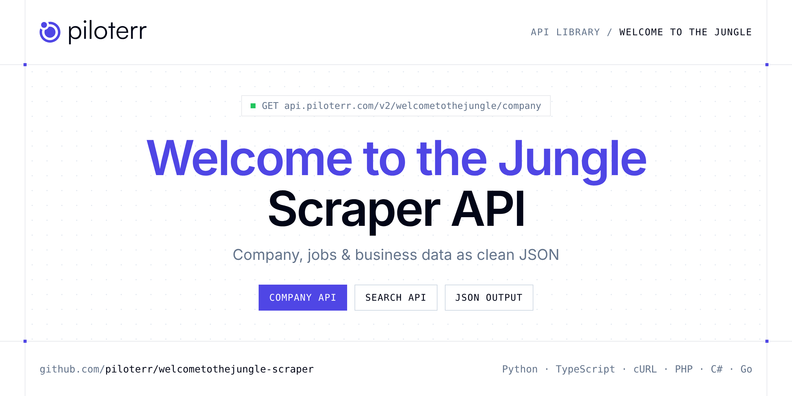

<p align="center">
  <a href="https://www.piloterr.com"></a>
</p>

# Welcome to the Jungle Scraper API

[](https://discord.gg/CFj3ph8aHU) [](https://app.piloterr.com) [](https://app.piloterr.com/openapi) [](LICENSE)

The **Piloterr Welcome to the Jungle Scraper API** lets you extract public data from Welcome to the Jungle as **clean, structured JSON** — no proxies, headless browsers or HTML parsing to maintain. Endpoints available in production:

- **Welcome to the Jungle Company API** — Welcome to the Jungle company profile: headcount, offices, sectors and website (1 credit).
- **Welcome to the Jungle Search API** — Search Welcome to the Jungle jobs.

Use it for lead generation, CRM enrichment, market mapping, investment research or job market analytics.

| Endpoint | Path | Credits | What you get |
|---|---|---|---|
| [Welcome to the Jungle Company API](#welcome-to-the-jungle-company-api) | `/v2/welcometothejungle/company` | 1 | Welcome to the Jungle company profile |
| [Welcome to the Jungle Search API](#welcome-to-the-jungle-search-api) | `/v2/welcometothejungle/search` | 1 | Search Welcome to the Jungle jobs. Returns offer cards and pagination (1 credit). |

## Table of contents

- [How it works](#how-it-works)
- [Welcome to the Jungle Company API](#welcome-to-the-jungle-company-api)
- [Welcome to the Jungle Search API](#welcome-to-the-jungle-search-api)
- [Code examples in other languages](#code-examples-in-other-languages)
- [Practical use cases](#practical-use-cases)
- [Why Piloterr?](#why-piloterr)
- [FAQ](#faq)
- [Related scrapers](#related-scrapers)
- [Support](#support)

## How it works

1. **Create a free Piloterr account** and copy your API key from the [dashboard](https://app.piloterr.com).
2. **Send a `GET` (or `POST`) request** to `https://api.piloterr.com/v2/...` with the header `x-api-key: YOUR_API_KEY`.
3. **Receive structured JSON** — Piloterr handles rendering, proxies, retries and parsing.

```bash
export PILOTERR_API_KEY="your-api-key"
pip install requests        # Python
# TypeScript: Node.js 18+ (native fetch), run with `npx tsx file.ts`
```

> Every endpoint accepts both `GET` (query string) and `POST` (JSON body with the same fields).

## Welcome to the Jungle Company API

Welcome to the Jungle company profile: headcount, offices, sectors and website (1 credit).

`GET | POST https://api.piloterr.com/v2/welcometothejungle/company` · **1 credit per request** · [Full reference](https://app.piloterr.com/openapi)

### Request parameters

| Parameter | Type | Required | Description |
|---|---|---|---|
| `query` | string | ✅ | Slug, company name, or a Welcome to the Jungle company URL. |
| `language` | string | — | fr (default) or en. en-gb and en-us count as en. Chooses the language of the profile text and URL. |

### Python example

```python
import json
import os
import requests

response = requests.get(
    "https://api.piloterr.com/v2/welcometothejungle/company",
    headers={"x-api-key": os.environ["PILOTERR_API_KEY"]},
    params={
        "query": "alan",
    },
    timeout=60,
)
response.raise_for_status()
data = response.json()

print(json.dumps(data, indent=2, ensure_ascii=False)[:2000])
```

### TypeScript example

```typescript
type WelcomeToTheJungleCompany = {
  url?: string;
  name?: string;
  slug?: string;
  links?: {
    url?: string;
    kind?: string;
  }[];
  labels?: unknown[];
  offices?: {
    city?: string;
    address?: string;
    country?: string;
    latitude?: number;
    zip_code?: string;
    longitude?: number;
    is_headquarter?: boolean;
  }[];
  sectors?: {
    name?: string;
    parent?: string;
  }[];
  website?: string;
  logo_url?: string;
  cover_url?: string;
  employees?: number;
  reference?: string;
  updated_at?: string;
  description?: string;
  equality_index?: number;
  equality_index_year?: number;
};

const params = new URLSearchParams({
  "query": "alan",
});

const response = await fetch(`https://api.piloterr.com/v2/welcometothejungle/company?${params}`, {
  headers: { "x-api-key": process.env.PILOTERR_API_KEY! },
});
if (!response.ok) throw new Error(`Piloterr error ${response.status}: ${await response.text()}`);

const data = (await response.json()) as WelcomeToTheJungleCompany;

console.log(JSON.stringify(data, null, 2).slice(0, 2000));
```

<details>
<summary><b>POST variant</b></summary>

```http
POST https://api.piloterr.com/v2/welcometothejungle/company
x-api-key: YOUR_API_KEY
Content-Type: application/json

{"query": "alan"}
```
</details>

### Output example

Example response from the API reference, abridged — real values depend on the page you scrape.

```json
{
  "url": "https://www.welcometothejungle.com/fr/companies/alan",
  "name": "Alan",
  "slug": "alan",
  "links": [
    {
      "url": "https://www.welcometothejungle.com/en/companies/alan",
      "kind": "canonical"
    },
    {
      "url": "https://www.welcometothejungle.com/en/companies/alan",
      "kind": "alternate"
    }
  ],
  "labels": [],
  "offices": [
    {
      "city": "Paris",
      "address": "117 Quai de Valmy",
      "country": "FR",
      "latitude": 48.87544,
      "zip_code": "75010",
      "longitude": 2.36335,
      "is_headquarter": true
    }
  ],
  "sectors": [
    {
      "name": "FinTech / InsurTech",
      "parent": "Banking / Insurance / Finance"
    }
  ],
  "website": "https://alan.com/",
  "logo_url": "https://cdn-images.welcometothejungle.com/9328mOxCAEq-4wFUg5LlLDkXZLLxIu1AZ-m93WhZqUM/rs:auto:400/q:85/czM6Ly93dHRqLXByb2R1Y3Rpb24vdXBsb2…",
  "cover_url": "https://cdn-images.welcometothejungle.com/LsvS1ejrz95JwWILFuMmUc65SMuLrvkbdSw-kAU6kRk/rs:auto:2000:450/g:fp:0:0.5/q:85/czM6Ly93dHRqLXByb2…",
  "employees": 400,
  "reference": "0dgXRez",
  "updated_at": "2026-10-27T15:35:19.451306Z",
  "description": "**🐼Who we are** **Alan is the healthcare super-app offering personalised healthcare & wellbeing to our members.** Founded in 2016 by Jean…",
  "equality_index": 92,
  "equality_index_year": 2025
}
```

### Response fields

| Field | Type | Description |
|---|---|---|
| `url` | string |  |
| `name` | string |  |
| `slug` | string |  |
| `links[]` | object[] |  |
| `links[].url` | string |  |
| `links[].kind` | string |  |
| `labels` | any[] |  |
| `offices[]` | object[] |  |
| `offices[].city` | string |  |
| `offices[].address` | string |  |
| `offices[].country` | string |  |
| `offices[].latitude` | number |  |
| `offices[].zip_code` | string |  |
| `offices[].longitude` | number |  |
| `offices[].is_headquarter` | boolean |  |
| `sectors[]` | object[] |  |
| `sectors[].name` | string |  |
| `sectors[].parent` | string |  |
| `website` | string |  |
| `logo_url` | string |  |
| `cover_url` | string |  |
| `employees` | integer |  |
| `reference` | string |  |
| `updated_at` | string |  |
| `description` | string |  |

## Welcome to the Jungle Search API

Search Welcome to the Jungle jobs. Returns offer cards and pagination (1 credit).

`GET | POST https://api.piloterr.com/v2/welcometothejungle/search` · **1 credit per request** · [Full reference](https://app.piloterr.com/openapi)

### Request parameters

| Parameter | Type | Required | Description |
|---|---|---|---|
| `query` | string | ✅ | Job keyword or a Welcome to the Jungle jobs-search URL. |
| `language` | string | — | fr (default) or en. en-gb and en-us count as en. A /fr/ or /en/ path in the URL overrides this. |
| `page` | number | — | Page from 1, 30 offers. A page value already in the URL overrides this. |

### Python example

```python
import json
import os
import requests

response = requests.get(
    "https://api.piloterr.com/v2/welcometothejungle/search",
    headers={"x-api-key": os.environ["PILOTERR_API_KEY"]},
    params={
        "query": "python",
    },
    timeout=60,
)
response.raise_for_status()
data = response.json()

print(json.dumps(data, indent=2, ensure_ascii=False)[:2000])
```

### TypeScript example

```typescript
type WelcomeToTheJungleSearch = {
  results?: {
    url?: string;
    city?: string;
    slug?: string;
    title?: string;
    remote?: string;
    company?: {
      name?: string;
      slug?: string;
      logo_url?: string;
      reference?: string;
    };
    country?: string;
    sectors?: string[];
    position?: number;
    reference?: string;
    profession?: string;
    salary_max?: number;
    salary_min?: number;
    published_at?: string;
    contract_type?: string;
    salary_period?: string;
    salary_currency?: string;
  }[];
  pagination?: {
    next?: string;
    page?: number;
    per_page?: number;
    total_pages?: number;
    total_results?: number;
  };
};

const params = new URLSearchParams({
  "query": "python",
});

const response = await fetch(`https://api.piloterr.com/v2/welcometothejungle/search?${params}`, {
  headers: { "x-api-key": process.env.PILOTERR_API_KEY! },
});
if (!response.ok) throw new Error(`Piloterr error ${response.status}: ${await response.text()}`);

const data = (await response.json()) as WelcomeToTheJungleSearch;

console.log(JSON.stringify(data, null, 2).slice(0, 2000));
```

<details>
<summary><b>POST variant</b></summary>

```http
POST https://api.piloterr.com/v2/welcometothejungle/search
x-api-key: YOUR_API_KEY
Content-Type: application/json

{"query": "python"}
```
</details>

### Output example

Example response from the API reference, abridged — real values depend on the page you scrape.

```json
{
  "results": [
    {
      "url": "https://www.welcometothejungle.com/fr/companies/warren-walter/jobs/developpeur-senior-python-node-js-ia-llm-rag-machine-learning-freelanc…",
      "city": "Paris",
      "slug": "developpeur-senior-python-node-js-ia-llm-rag-machine-learning-freelance-h-f_paris",
      "title": "Développeur Senior Python / Node.js – IA, LLM, RAG & Machine Learning Freelance (H/F)",
      "remote": "partial",
      "company": {
        "name": "Warren Walter",
        "slug": "warren-walter",
        "logo_url": "https://cdn-images.welcometothejungle.com/fvPxjAqiAdHkDVgw0Wv2mGh7J1agohB0wDryhKh1vog/rs:auto:400/q:85/czM6Ly93dHRqLXByb2R1Y3Rpb24vdXBsb2…",
        "reference": "9onX3U"
      },
      "country": "FR",
      "sectors": [
        "Application mobile",
        "Logiciels"
      ],
      "position": 1,
      "reference": "51c6ad1d-9fe0-431e-9c42-566fef3a08f2",
      "profession": "Développeur de logiciels",
      "salary_max": 550,
      "salary_min": 450,
      "published_at": "2026-10-26T09:49:08Z",
      "contract_type": "freelance",
      "salary_period": "daily",
      "salary_currency": "EUR"
    }
  ],
  "pagination": {
    "next": "https://www.welcometothejungle.com/fr/jobs?query=python&page=2",
    "page": 1,
    "per_page": 30,
    "total_pages": 34,
    "total_results": 6712
  }
}
```

### Response fields

| Field | Type | Description |
|---|---|---|
| `results[]` | object[] |  |
| `results[].url` | string |  |
| `results[].city` | string |  |
| `results[].slug` | string |  |
| `results[].title` | string |  |
| `results[].remote` | string |  |
| `results[].company` | object |  |
| `results[].country` | string |  |
| `results[].sectors` | string[] |  |
| `results[].position` | integer |  |
| `results[].reference` | string |  |
| `results[].profession` | string |  |
| `results[].salary_max` | integer |  |
| `results[].salary_min` | integer |  |
| `results[].published_at` | string |  |
| `results[].contract_type` | string |  |
| `results[].salary_period` | string |  |
| `results[].salary_currency` | string |  |
| `pagination` | object |  |
| `pagination.next` | string |  |
| `pagination.page` | integer |  |
| `pagination.per_page` | integer |  |
| `pagination.total_pages` | integer |  |
| `pagination.total_results` | integer |  |

## Code examples in other languages

Ready-to-run examples live in the [`examples/`](examples) folder. Each one reads your key from the `PILOTERR_API_KEY` environment variable.

| Language | Company | Search |
|---|---|---|
| cURL (Bash) | [`company`](examples/curl/company.sh) | [`search`](examples/curl/search.sh) |
| PHP | [`company`](examples/php/company.php) | [`search`](examples/php/search.php) |
| C# | [`company`](examples/csharp/Company.cs) | [`search`](examples/csharp/Search.cs) |
| Go | [`company`](examples/go/company.go) | [`search`](examples/go/search.go) |
| Java | [`company`](examples/java/CompanyExample.java) | [`search`](examples/java/SearchExample.java) |
| Ruby | [`company`](examples/ruby/company.rb) | [`search`](examples/ruby/search.rb) |
| Node.js | [`company`](examples/nodejs/company.mjs) | [`search`](examples/nodejs/search.mjs) |

## Practical use cases

- **Lead generation** — Build target account lists from public company data.
- **CRM enrichment** — Keep firmographics, websites and descriptions up to date.
- **Market mapping** — Map competitors and segments across countries and industries.
- **Investment research** — Screen companies, funding and signals for deal flow.
- **Job market analytics** — Track hiring, roles and salaries where available.

## Why Piloterr?

- **No infrastructure** — no proxies, headless browsers or CAPTCHA solving to run yourself.
- **Structured JSON** — stable, documented fields instead of brittle HTML selectors.
- **Pay per request** — transparent credit cost per endpoint, failed requests are retried for you.
- **One API key, hundreds of sources** — Welcome to the Jungle plus many other e-commerce, search and company data endpoints in the [Piloterr library](https://www.piloterr.com/library).
- **Any language** — plain HTTPS + JSON, with examples for Python, TypeScript, cURL, PHP, C#, Go, Java, Ruby and Node.js.

## FAQ

### Is it legal to scrape Welcome to the Jungle?

Collecting publicly available data is generally allowed in many jurisdictions, but rules depend on your country, the data you collect and how you use it. Avoid personal data unless you have a lawful basis, respect the website's terms where they apply, and get legal advice for your specific use case. This is not legal advice.

### Do I need proxies or a headless browser?

No. Piloterr handles rendering, proxy rotation and retries on its side. You only send an HTTPS request with your `x-api-key` header and receive JSON.

### How much does a request cost?

Credits per call: `/v2/welcometothejungle/company` **1**, `/v2/welcometothejungle/search` **1**. See the [Piloterr website](https://www.piloterr.com) for plans.

### What data does the Welcome to the Jungle API return?

Each endpoint returns structured JSON: **Welcome to the Jungle Company** — `url`, `name`, `slug`, `links[]`, `links[].url`, `links[].kind`; **Welcome to the Jungle Search** — `results[]`, `results[].url`, `results[].city`, `results[].slug`, `results[].title`, `results[].remote`.

### How do I paginate Welcome to the Jungle results?

Use the `page` parameter and keep requesting while the response indicates more results.

### Can I target a specific country or language?

Yes, use `language` — see the parameter tables above for accepted values.

### Which languages are supported?

Any language that can make an HTTP request. This README shows Python and TypeScript; the [`examples/`](examples) folder contains cURL, PHP, C#, Go, Java, Ruby and Node.js.

## Related scrapers

- [Company Database Scraper API](https://github.com/piloterr/company-data-api)
- [Crunchbase Scraper API](https://github.com/piloterr/crunchbase-scraper)
- [Europages Scraper API](https://github.com/piloterr/europages-scraper)
- [Fiverr Scraper API](https://github.com/piloterr/fiverr-scraper)
- [G2 Scraper API](https://github.com/piloterr/g2-scraper)
- [GitHub Scraper API](https://github.com/piloterr/github-scraper)
- [All Piloterr scrapers on GitHub](https://github.com/piloterr)

## Support

- 💬 Join the [Piloterr Discord](https://discord.gg/CFj3ph8aHU) to ask questions and share what you build.
- 📚 Browse the [API reference (OpenAPI)](https://app.piloterr.com/openapi) and the [Piloterr library](https://www.piloterr.com/library).
- 🔑 [Get your API key](https://app.piloterr.com).

---

<p align="center">
  <a href="https://www.piloterr.com">
    <picture>
      <source media="(prefers-color-scheme: dark)" srcset="images/logo-dark.svg">
      
    </picture>
  </a>
  <br>
  <sub>Built by <a href="https://www.piloterr.com">Piloterr</a> — web scraping APIs for e-commerce, search, real estate and more, one API key.</sub>
</p>

<sub>Welcome to the Jungle is a trademark of its respective owner. This repository is not affiliated with or endorsed by Welcome to the Jungle. Examples are released under the MIT license.</sub>
